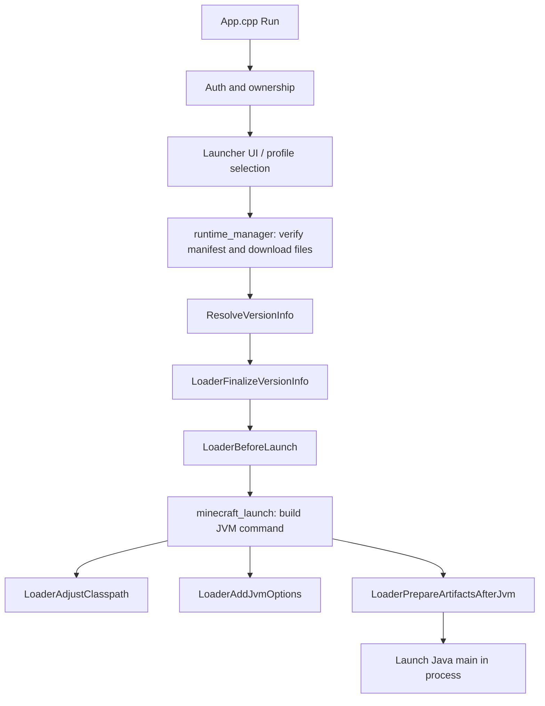

# Architecture

This page describes how the Bandit Launcher UWP host is organized after the `App.cpp` split. It is meant for contributors who need to find launch, auth, UI, or loader code quickly.

## Overview

Bandit Launcher is a single UWP process that:

1. Authenticates the user with Microsoft and verifies Minecraft Java ownership.
2. Manages profiles, mods, and launcher UI state.
3. Verifies and downloads official runtime files into `LocalState`.
4. Embeds the JVM, applies loader specific launch rules, and starts Minecraft.
5. Exposes optional local network file access and diagnostics collection.

The UWP shell in `MC.Xbox/App.cpp` orchestrates startup and menu flow. Most behavior lives in feature folders under `MC.Xbox/`.

## Source Layout

```text
MC.Xbox/
  App.cpp                 UWP entry, App lifecycle, Run() orchestration
  runtime_config.h.in     Build time version template
  common/                 Shared helpers, crash reports
  net/                    HTTP client, remote file server, web relay server
  auth/                   Microsoft / Minecraft auth
  ui/                     Launcher UI, auth screen, launcher mouse, UI globals
  mods/                   Modrinth browser, defaults, mod types
  profiles/               Profile storage and target selection
  launch/                 Runtime downloads, JVM launch, loader dispatch
    app_globals.*
    runtime_manager.*
    minecraft_launch.*
    launch_internal.*
    loaders/
      loader.*            Loader dispatch facade
      loader_common.*     Shared loader parsing/helpers
      fabric.*            Fabric launch provider
      neoforge.*          NeoForge launch provider
      forge.*             Forge launch provider with legacy and modern paths
      cleanroom.*         Cleanroom launch provider for Forge 1.12.2
```

`build.ps1` compiles sources from these folders with include paths for `.`, `common`, `net`, `auth`, `ui`, `mods`, `profiles`, `launch`, `launch/loaders`, and `mouse_support` for the relay mouse API.

## Module Responsibilities

| Module | Responsibility |
| --- | --- |
| `App.cpp` | `wWinMain`, CoreApplication lifecycle, high level `Run()` sequencing between auth, UI, downloads, and launch. |
| `common/launcher_common` | Path helpers, environment access, shared string/path utilities used across modules. |
| `common/i18n` | Language files from `lang` in the package and in `LocalState`, the saved language choice, and `Tr` and `TrFormat`, which look a string up by its English text and fall back to it. |
| `common/crash_report` | Collect launcher and game diagnostics into crash report archives. |
| `auth/minecraft_auth` | Device code sign in, token exchange, ownership verification, session state. |
| `ui/launcher_ui` | Main menu rendering and interaction. |
| `ui/auth_screen` | Sign in screen and QR/device code presentation. |
| `ui/launcher_mouse` | Loads `mouse_support.dll` and drives the relay cursor in launcher menus and the mod browser. |
| `mods/mods_browser` | Modrinth search, recommended list loading, version resolution, install into active profile. |
| `mods/mod_defaults` | Launcher seeded mod compatibility defaults per target. |
| `profiles/profiles` | Profile CRUD, per profile game dirs, selected launch target. |
| `net/http_client` | Shared HTTP helpers for downloads and APIs. |
| `net/update_check` | Looks up the newest release on the build's channel and the changelog on GitHub, keeps the answer in `LocalState\updates`, and turns changelog markdown into plain text for the What's new page and the new version notice. The channel comes from `-ReleaseChannel` on `build.ps1`, so local builds do not check. |
| `net/remote_file_server` | Local network upload/download UI backend. |
| `net/html_translate` | Translates a page the Remote Files server sends by looking up its text, titles and placeholders by their English text. |
| `net/web_relay_server` | Browser mouse touchpad served on the local network, forwarded to the relay input port. |
| `launch/runtime_manager` | Manifest verification, parallel downloads, version JSON resolution, native library prep. |
| `launch/minecraft_launch` | Shared JVM embed path: classpath assembly, natives, game args, process local Java startup. |
| `launch/launch_internal` | Low level Java invocation helpers used by loader specific prep. |
| `launch/loaders/*` | Loader specific version finalization, artifact prep, classpath, and JVM args. |

## Launch Flow



### Runtime preparation

`launch/runtime_manager.cpp` owns most download and version resolution work:

- Reads packaged `download_manifest.tsv` and per target manifests under `runtime/manifests/`.
- Verifies SHA1 hashes under `LocalState`.
- Downloads missing or stale official libraries, client metadata, and assets.
- Prepares native library folders for the selected target.

When version JSON needs loader specific fields, `ResolveVersionInfo()` delegates to `LoaderFinalizeVersionInfo()` in `launch/loaders/loader.cpp`.

### Shared JVM launch

`launch/minecraft_launch.cpp` handles the common embed path:

- Locates packaged JREs (`jre`, `jre21`, and `jre17` when packaged for Java 17 targets).
- Syncs bundled loader mods from `runtime/version-mods/<target-id>/` into the active profile `mods/` folder for Forge and NeoForge launches.
- Builds the base classpath from resolved version data.
- Applies UWP native library paths and GLFW shim placement.
- Calls loader hooks before adjusting classpath and JVM options.
- Starts the selected main class in the same UWP process.

Loader specific behavior should not be reimplemented here. Add or extend a loader module instead.

## Loader Plugin Pattern

`launch/loaders/loader.h` defines the loader dispatch surface:

| Hook | Purpose |
| --- | --- |
| `LoaderFinalizeVersionInfo` | Fill loader specific version metadata after base resolution. |
| `LoaderBeforeLaunch` | Pre launch filesystem or config preparation. |
| `LoaderAdjustClasspath` | Add loader jars, patched clients, or module path entries. |
| `LoaderAddJvmOptions` | Add loader specific JVM flags, patch module args, or system properties. |
| `LoaderPrepareArtifactsAfterJvm` | Late artifact generation that needs JVM helpers. |

`launch/loaders/loader.cpp` parses the active loader id and forwards each hook to the matching provider.

Shared parsing helpers live in `launch/loaders/loader_common.*`.

### Fabric

`launch/loaders/fabric.cpp` handles Fabric loader versioning, classpath additions, and Fabric specific JVM arguments for supported targets.

### NeoForge

`launch/loaders/neoforge.cpp` is the largest provider today. It covers:

- NeoForge install metadata and artifact preparation.
- FML/UCP config generation.
- Patched client handling from downloaded official inputs.
- securejarhandler patch module arguments.
- NeoForge classpath and JVM option assembly.

NeoForge generates patched client artifacts on first launch from downloaded official inputs. Do not commit or redistribute generated NeoForge client jars.

### Forge

`launch/loaders/forge.cpp` implements the experimental Forge provider. It follows the same loader hook pattern as NeoForge:

- Reads Forge install metadata from the generated download manifest.
- Prepares SRG client artifacts from downloaded official inputs (similar to NeoForge patched client generation).
- Assembles Forge classpath and JVM options, including `legacyClassPath` alignment for FML.
- Runs late artifact preparation after the embedded JVM starts when needed.

Forge patched client jars are generated locally during build or first launch prep from official inputs. Do not commit or redistribute generated Forge client jars.

Modern Forge controller targets from 1.21 through 26.2 reuse the NeoForge shared source with a Forge entrypoint. Minecraft 1.21.2 has no Forge row because no matching loader was published. Older catalog rows may still exist before their controller providers are implemented.

### Cleanroom

`launch/loaders/cleanroom.cpp` runs Minecraft 1.12.2 with Forge through [Cleanroom](https://github.com/CleanroomMC/Cleanroom), a Forge 1.12.2 fork that runs on modern Java and LWJGL 3. Plain 1.12.2 uses LWJGL 2, which opens its own Win32 window and never goes through the GLFW shim. Cleanroom swaps it for LWJGL 3 plus lwjglxx, an LWJGL 2 API on top of GLFW, so 1.12.2 gets the same windowing, input and graphics path as current versions.

The target is pinned to Cleanroom `0.3.35-alpha`, which runs on Java 21 and LWJGL 3.3.6. Later releases do not work here. `0.4` added the Kirino render engine, which binds the wrong texture while the block atlas uploads. `0.5.13` and later need Java 25, and `0.7.0` moved windowing to SDL.

- The manifest mirrors Cleanroom's own library list. Vanilla's LWJGL 2, netty and oshi come out, and only authlib, realms, text2speech and paulscode are kept from vanilla. Keeping vanilla's LWJGL 2 next to LWJGL 3 fails with `NoSuchMethodError`. Only x64 natives are taken.
- The jar Cleanroom runs from is only published inside its installer. The copy on Cleanroom's maven is a development build without the binpatches. `CleanroomBeforeLaunch` extracts it from the downloaded installer into `game/libraries`.
- There is no install step beyond that. Cleanroom binpatches the vanilla client while classes load, like Forge did on 1.12, so the runtime jar goes on the classpath ahead of the client.
- `CleanroomBeforeLaunch` seeds three config values the first time. The Forge loading splash is turned off, because it draws from a second thread on a shared GL context and the shim only has one. Forge's IME blocking is turned off, since it loads `imm32` through JNA and the UWP container refuses that. The patch-mod check is turned off, so the game does not stop at a "press any key" screen.
- Chunk render buffers take about 10 MB each and 1.12 makes one per builder, so Cleanroom launches with `-Xmx2560M -XX:MaxDirectMemorySize=1G`.
- lwjglxx resets its idea of the window size after the first poll and would draw at 854x480. The GLFW shim re-sends the real window and framebuffer size on the first swap when it differs from what was asked for.
- `patch/cleanroom/` builds `cleanroom-uwp-patch.jar` with no-op replacements for the dwmapi, ntdll and taskbar hooks in Cleanroom `0.4` and later. It is skipped for `0.3.35`, which has none of them.
- Mod browsers search Forge mods for this target, and the launch screen labels it Forge.

The 1.12.2 controller mod lives in `controller_mod/cleanroom/`. It is written against SRG names and compiled against a vanilla client renamed with mcp_config's `joined.tsrg`, with the Cleanroom jar on the classpath as shipped. Forge APIs whose signatures use vanilla classes are avoided for that reason. It shares `controller_mod/core` with the other loaders and has the same features: button guides, snap navigation, the radial menu, the settings screen and the console keyboard. Input goes into lwjglxx's own mouse and keyboard event queues, so vanilla handles hover, drag and clicks in every screen, modded ones included.

To add another Forge target:

1. Extend the provider logic in `launch/loaders/forge.cpp`.
2. Add or update the target row in `config/versions.tsv`.
3. Ensure `build.ps1` generates the matching manifest and any per target controller mod jar.
4. Confirm dispatch in `launch/loaders/loader.cpp` covers the new loader version.

## Mouse Relay

Xbox UWP does not expose a real mouse, so mouse input comes from an optional relay. `mouse_support.dll` (built from `mouse_support/`) is the single mouse source: it owns the UDP listener and exposes frames through a small C API. The GLFW shim links it for in game mouse input, and the launcher loads it through `ui/launcher_mouse` to drive the cursor in menus and the mod browser. Input can come from the native Bandit Mouse Relay app in `tools/mouse-relay/` (Windows and Android, UDP `7331`) or from `net/web_relay_server`, which serves a browser touchpad on port `6090` so any phone or PC can relay without installing an app.

## Build Time vs Runtime Configuration

At build time, `build.ps1` generates `runtime_config.h` from `MC.Xbox/runtime_config.h.in` using values from `scripts/config.ps1` and CLI overrides. That header supplies default package versions to host modules.

At runtime, the launcher reads:

- `runtime/version_catalog.tsv` for selectable targets.
- `runtime/manifests/<target-id>.tsv` for per target download requirements.
- `download_manifest.tsv` for shared official runtime verification.

Changing the default target requires updating `scripts/config.ps1` and usually `config/versions.tsv`. See [BUILDING.md](BUILDING.md) for the full checklist.

## Related Projects In This Repo

| Path | Role in launch |
| --- | --- |
| `glfw_shim/` | Replaces desktop `glfw.dll` behavior for UWP windowing, input, and WGL. |
| `compat_mod/` | Fabric compatibility mod: filesystem, graphics, and sandbox fixes per target. |
| `controller_mod/` | Shared controller core plus loader-specific controller mods built into `runtime/version-mods/<target-id>/`. |
| `patch/` | Supplies patched Fabric Loader classes and securejarhandler UWP changes packaged into the APPX. |
| `mouse_support/` | Standalone DLL that owns relay mouse input; linked into the GLFW shim for in game use and loaded by the launcher for menu use. |
| `mesa-runtime/` | Series console OpenGL translation runtime packaged under `graphics/`. |

## Where To Start For Common Tasks

| Task | Start here |
| --- | --- |
| Add a Fabric target | `config/versions.tsv`, `scripts/config.ps1`, `launch/loaders/fabric.cpp`, [BUILDING.md](BUILDING.md) |
| Add a NeoForge target | `config/versions.tsv`, manifest generation in `scripts/`, `launch/loaders/neoforge.cpp`, `controller_mod/neoforge/` if controller support is needed |
| Add another Forge target | `launch/loaders/forge.cpp`, `config/versions.tsv`, `controller_mod/forge/` if controller support is needed |
| Change bundled controller behavior | `controller_mod/`, `glfw_shim/glfw_uwp.cpp`, `mods/mod_defaults.cpp` |
| Change sign in or ownership checks | `auth/minecraft_auth.cpp` |
| Change main menu or auth UI | `ui/launcher_ui.cpp`, `ui/auth_screen` |
| Change downloads or repair behavior | `launch/runtime_manager.cpp` |
| Change Modrinth install behavior | `mods/mods_browser.cpp` |
| Change recommended mods | `config/recommended-mods.json` |
| Change remote uploads | `net/remote_file_server.cpp` |
| Change relay mouse behavior | `mouse_support/`, `glfw_shim/glfw_uwp.cpp`, `ui/launcher_mouse.cpp`, `net/web_relay_server.cpp` |

## Auth Boundary

Bandit Launcher requires legitimate Microsoft/Xbox authentication and Minecraft entitlement verification. Architecture changes must keep that boundary intact. Do not add offline fallbacks, optional auth switches, or alternate launch paths that skip ownership checks.

See [CONTRIBUTING.md](../CONTRIBUTING.md) and [LEGAL.md](LEGAL.md).
